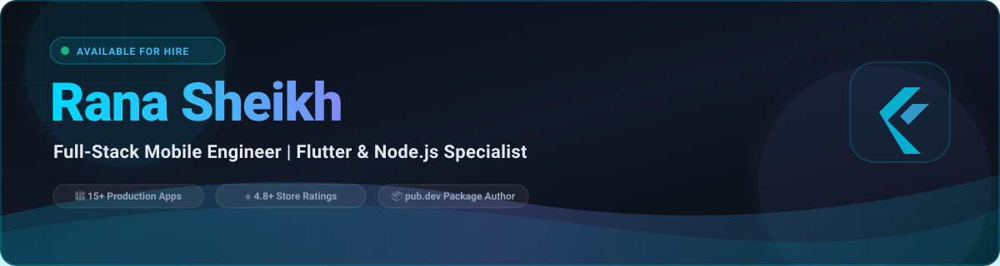

<div align="center">

<!-- Local Native SVG Banner (Guaranteed 100% Uptime & No Broken Images) -->


<br/><br/>

<!-- Clean Typing SVG (Optimized with JetBrains Mono) -->
<a href="https://ranasheikh.is-a.dev/">
  
</a>

<br/><br/>

<!-- Status & Highlights Badges -->
<p align="center">
  
  &nbsp;
  
  &nbsp;
  
  &nbsp;
  
</p>

<!-- Social & Contact Quick Links -->
<p align="center">
  <a href="https://ranasheikh.is-a.dev/" target="_blank">
    
  </a>
  &nbsp;
  <a href="https://linkedin.com/in/ranasheikh" target="_blank">
    
  </a>
  &nbsp;
  <a href="mailto:rana6424sheikh@gmail.com">
    
  </a>
  &nbsp;
  <a href="https://wa.me/8801613475871" target="_blank">
    
  </a>
</p>

</div>

---

## 👨‍💻 Professional Summary


Results-driven **Full-Stack Mobile Engineer** with over **4+ years of professional experience** architecting and shipping **15+ production-grade** cross-platform applications across **Fintech, Healthtech, AI, and On-Demand Marketplace** domains.

- 💼 **Current Position:** Flutter Developer at **SM Technology** (Dhaka, Bangladesh).
- 📱 **Proven Track Record:** Consistently maintaining high store ratings (**4.8+ stars**), optimizing backend latency, and publishing open-source packages on **pub.dev**.
- 🏗️ **Core Philosophy:** Clean Architecture, scalable reactive state management (**BLoC, GetX, Riverpod**), modular UI libraries, and robust backend integrations (**Node.js, Firebase, Supabase, WebSockets**).
- 🎓 **Education:** Diploma in Computer Science & Technology (CST) at **Mymensingh Polytechnic Institute** (2022 – 2026).

```dart
// 📱 rana_sheikh.dart

class RanaSheikh extends FullStackMobileEngineer {
  final String name     = "Rana Sheikh";
  final String role     = "Full-Stack Mobile Engineer | Flutter & Node.js Specialist";
  final String location = "Mymensingh / Dhaka, Bangladesh 🇧🇩";
  final int    experienceYears = 4;

  final List<String> coreStack = [
    "Flutter & Dart",
    "Kotlin (Android) & Swift (iOS)",
    "Node.js & Express.js",
    "Firebase & Supabase",
    "BLoC, GetX & Riverpod",
    "REST APIs & WebSockets",
    "Clean Architecture & CI/CD",
  ];

  final Map<String, String> liveHighlights = {
    "🛍️ Doerly"        : "On-demand Service Marketplace (Play Store & Web)",
    "🎙️ WanderX"       : "AI Voice-to-Voice Translation App (Play Store)",
    "🌙 Sable Dreams"  : "AI-Powered Journaling & Reflection Sanctuary (Play Store)",
    "🌐 Web Portfolio" : "https://ranasheikh.is-a.dev/",
  };

  String getContact() => "rana6424sheikh@gmail.com";
}
```

<br clear="right"/>

---

## 🚀 Featured Flagship Production Apps (Live on Stores)

<!-- 1. Doerly Card -->
<table width="100%">
  <tr>
    <td width="58%" valign="top">
      <h3>🛍️ Doerly — Local Services Marketplace</h3>
      <p><b>Dual-Role On-Demand Marketplace Platform (Client &amp; Provider in One Tap)</b></p>
      <p>Connects local service seekers with verified service providers in real time. Features seamless client/provider mode switching, in-app messaging, real-time job bidding, live GPS tracking, automated work timers, and secure Stripe payouts.</p>
      <p>
        
        
        
        
        
      </p>
      <br/>
      <a href="https://play.google.com/store/apps/details?id=com.buddyhelp.buddyhelpapp" target="_blank">
        
      </a>
      &nbsp;
      <a href="https://www.doerly.pro" target="_blank">
        
      </a>
      <br/><br/>
      <details>
        <summary><b>🔍 Tap to View More Screenshots (5 Screens)</b></summary>
        <br/>
        
        
        
      </details>
    </td>
    <td width="42%" align="center" valign="middle">
      
      
    </td>
  </tr>
</table>

<br/>

<!-- 2. WanderX Card -->
<table width="100%">
  <tr>
    <td width="58%" valign="top">
      <h3>🎙️ WanderX — AI Voice Translation &amp; Subtitles</h3>
      <p><b>Real-Time Voice-to-Voice AI Translation Platform</b></p>
      <p>Powered by advanced AI speech models. Delivers instant vocal-to-vocal translation, automated video subtitle generation, cross-platform audio sharing, and specialized audio processing pipelines to preserve natural tone and nuance.</p>
      <p>
        
        
        
        
      </p>
      <br/>
      <a href="https://play.google.com/store/apps/details?id=com.wanderx.app" target="_blank">
        
      </a>
      <br/><br/>
      <details>
        <summary><b>🔍 Tap to View More Screenshots (9 Screens)</b></summary>
        <br/>
        
        
        
      </details>
    </td>
    <td width="42%" align="center" valign="middle">
      
      
    </td>
  </tr>
</table>

<br/>

<!-- 3. Sable Dreams Card -->
<table width="100%">
  <tr>
    <td width="58%" valign="top">
      <h3>🌙 Sable Dreams — AI Journaling &amp; Self-Growth</h3>
      <p><b>Mindful Journaling &amp; Daily Becoming Sanctuary</b></p>
      <p>An elevated daily sanctuary blending reflection, affirmation, mood tracking, curated book recommendations, and <i>Sable</i> — an intelligent AI reflection companion for personal wellness, mindfulness, and manifestation.</p>
      <p>
        
        
        
        
      </p>
      <br/>
      <a href="https://play.google.com/store/apps/details?id=com.sabledream.sabledreamapp" target="_blank">
        
      </a>
      <br/><br/>
      <details>
        <summary><b>🔍 Tap to View More Screenshots (9 Screens)</b></summary>
        <br/>
        
        
        
      </details>
    </td>
    <td width="42%" align="center" valign="middle">
      
      
    </td>
  </tr>
</table>

---

## 💼 Additional Client & Enterprise Projects

<table width="100%">
  <tr>
    <!-- Project 1: BHookD -->
    <td width="50%" valign="top">
      <h3>🛞 BHookD</h3>
      <p><b>On-Demand Roadside Assistance &amp; Towing</b></p>
      <p>Connects stranded drivers with nearby towing trucks and emergency roadside mechanics via real-time GPS dispatch and live job status tracking.</p>
      <p>
        
        
        
      </p>
      <p>
        
        
      </p>
      <details>
        <summary><b>🔍 Tap to View More Previews</b></summary>
        <br/>
        
        
      </details>
    </td>
    <!-- Project 2: Blossom Wellness -->
    <td width="50%" valign="top">
      <h3>🌸 Blossom Wellness</h3>
      <p><b>Holistic Health, Habit Coaching &amp; Mindfulness</b></p>
      <p>Daily wellness routine builder, mindfulness logs, habit coaching, guided audio meditations, and comprehensive personal progress tracking.</p>
      <p>
        
        
        
      </p>
      <p>
        
        
      </p>
      <details>
        <summary><b>🔍 Tap to View More Previews</b></summary>
        <br/>
        
        
      </details>
    </td>
  </tr>
  <tr>
    <!-- Project 3: ContractClear -->
    <td width="50%" valign="top">
      <h3>⚖️ ContractClear</h3>
      <p><b>AI Legal Document &amp; Contract Analysis</b></p>
      <p>Intelligent legal document parser, clause-level risk detection, automated compliance verification, and smart contract audit assistant.</p>
      <p>
        
        
        
      </p>
      <p>
        
        
      </p>
      <details>
        <summary><b>🔍 Tap to View More Previews</b></summary>
        <br/>
        
        
      </details>
    </td>
    <!-- Project 4: Halal Motives -->
    <td width="50%" valign="top">
      <h3>🌙 Halal Motives</h3>
      <p><b>Islamic Quotes &amp; Daily Spiritual Motivation</b></p>
      <p>Curated Islamic reminders, daily Quranic reflections, elegant typographic cards, notification engine, and offline quote bookmarking.</p>
      <p>
        
        
        
      </p>
      <p>
        
        
      </p>
      <details>
        <summary><b>🔍 Tap to View More Previews</b></summary>
        <br/>
        
        
      </details>
    </td>
  </tr>
</table>

---

## 🛠️ Featured Open-Source Repositories

Explore my open-source tools, developer utilities, and software packages:

| Project | Description | Tech Stack | Status |
|---|---|---|:---:|
| 🛡️ [**git-shield**](https://github.com/ranasheikh11/git-shield) | Advanced Git security scanner for malicious files, backdoors & auto-run exploits | Shell / Git Hooks | Active |
| ⚡ [**Post-Lite**](https://github.com/ranasheikh11/Post-Lite) | Lightweight cross-platform API testing client for desktop & web | Flutter / Dart | Active |
| 📱 [**Show-Off**](https://github.com/ranasheikh11/Show-Off) | Mobile developer project showcase app with modern UI and smooth animations | Flutter / Dart | Active |
| 📝 [**JR-Editx**](https://github.com/ranasheikh11/JR-Editx) | Fast code editing, note taking and text manipulation utility | Dart / Desktop | Active |
| 🔒 [**jr-pro-vpn**](https://github.com/ranasheikh11/jr-pro-vpn) | High-speed mobile VPN application architecture | Flutter / Android | Active |
| 🌐 [**snipent_hub**](https://github.com/ranasheikh11/snipent_hub) | Code snippets sharing platform with full-stack authentication | Flutter / Node.js | Active |

---

## 💻 Tech Stack & Engineering Arsenal

<div align="center">

### 📱 Mobile & Frontend


### ⚙️ Backend, Database & Cloud


### 🛠️ Architecture, Tools & DevOps


</div>

<br/>

<div align="center">

| Domain | Technologies & Frameworks |
|---|---|
| **Mobile Development** | Flutter, Dart, Kotlin (Android), Swift (iOS), Clean Architecture, Multi-Module |
| **State Management** | BLoC, GetX, Riverpod, Provider |
| **Backend & Cloud** | Node.js, Express.js, RESTful APIs, WebSockets (Socket.IO), Firebase, Supabase |
| **Databases** | MongoDB, Cloud Firestore, SQLite, Hive, Supabase PostgreSQL |
| **DevOps & Release** | Git, GitHub Actions, Google Play Console, Apple App Store, CI/CD Pipelines |

</div>

---

## 💼 Work Experience

```
📅 2022 ─────────────────────────────────────────────────────── 2026+
  │
  ├─ 🏢 Cube Computer (Flutter Developer)               [Jan 2022 – Jun 2024]
  │   • Led end-to-end development of mobile apps from concept to App Store & Play Store.
  │   • Managed release cycles and resolved critical production issues.
  │
  ├─ 🏢 Jronix Software Solutions (Remote Developer)    [Jul 2024 – Jan 2025]
  │   • Engineered high-traffic enterprise Flutter apps using REST APIs & Supabase.
  │   • Built modular UI libraries cutting sprint delivery time by 30%.
  │   • Published reusable open-source Flutter packages on pub.dev.
  │
  └─ 🚀 SM Technology (Flutter Developer)               [Jul 2025 – Present]
      • Engineered 15+ production-grade mobile applications with high performance.
      • Architected scalable state management solutions using BLoC & GetX.
      • Optimized real-time backend integrations with Node.js and Firebase.
```

---

## 📊 GitHub Analytics

<div align="center">


&nbsp;


<br/><br/>


</div>

---

## 🌐 Let's Connect & Collaborate!

<div align="center">

<a href="https://ranasheikh.is-a.dev/" target="_blank">
  
</a>
&nbsp;
<a href="https://linkedin.com/in/ranasheikh" target="_blank">
  
</a>
&nbsp;
<a href="mailto:rana6424sheikh@gmail.com">
  
</a>
&nbsp;
<a href="https://wa.me/8801613475871" target="_blank">
  
</a>

<br/><br/>

<sub>Crafted with ❤️ by Rana Sheikh | Full-Stack Mobile Engineer</sub>

</div>
